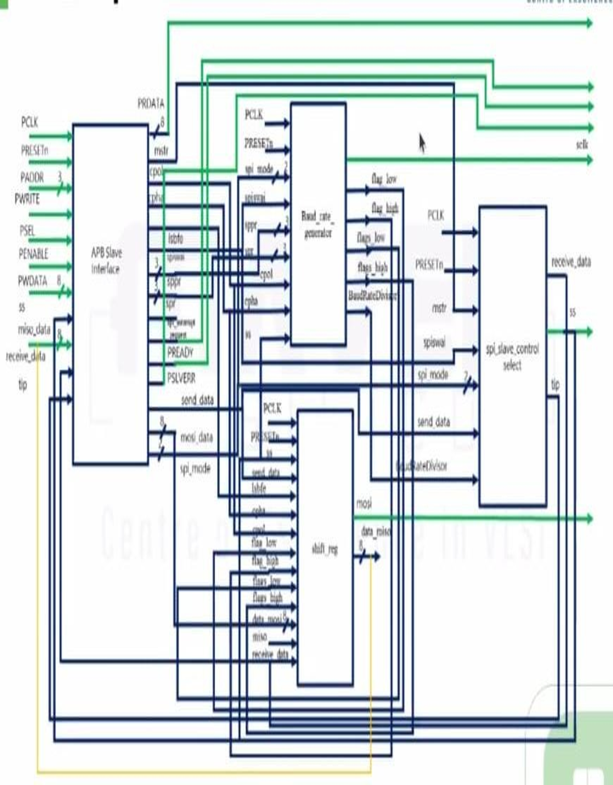

# APB-Interfaced SPI Master IP Core

**Maven Silicon internship project**  
**Completed:** 19 July 2025  
**HDL:** Verilog  
**Tool reported in project documentation:** AMD/Xilinx Vivado 2020.2

## Overview

This repository contains the Verilog RTL and simulation testbenches for an SPI Master design with an AMBA APB slave programming interface. The design is organized as a top-level module and four functional submodules.

The repository reflects the source files and design evidence supplied for the project. Please consult the RTL and testbenches for exact behavior and supported configuration.

## Architecture

The design is organized around these modules:

- `spi_master_top` — top-level integration of the APB interface and SPI control/data-path blocks.
- `apb_slave_interface` — APB register access and control/status interface.
- `baud_rate_generator` — SPI clock timing and baud-rate divider logic.
- `shift_register` — serial transmit/receive shifting and MOSI/MISO data handling.
- `spi_slave_control_select` — SPI transaction and slave-select control.

The design exposes APB signals such as `PADDR`, `PSEL`, `PENABLE`, `PWRITE`, `PWDATA`, `PRDATA`, `PREADY`, and `PSLVERR`, along with SPI signals including `SCLK`, `MOSI`, `MISO`, and `SS`.

### Architecture diagram



## Repository layout

```text
apb-spi-master-ip-core/
├── README.md
├── .gitignore
├── rtl/
│   ├── spi_master_top.v
│   ├── apb_slave_interface.v
│   ├── baud_rate_generator.v
│   ├── shift_register.v
│   └── spi_slave_control_select.v
├── tb/
│   ├── tb_spi_master_top.v
│   ├── apb_slave_interface_tb.v
│   ├── tb_baud_rate_generator.v
│   ├── shift_register_tb.v
│   └── tb_spi_slave_control_select.v
├── vivado/
│   └── synthesis/
└── docs/
    ├── architecture/
    ├── simulation/
    └── synthesis/
```

## Simulation evidence

The `tb/` directory contains separate testbenches for the top-level SPI Master and its component modules. Captured waveform screenshots are available under `docs/simulation/`.

The screenshots are supporting evidence; they are not a substitute for running the testbenches in a simulator. Testbench coverage and expected results should be checked against the source before treating the design as production-ready.

## Synthesis evidence

The project report records synthesis using Vivado 2020.2. The report lists the following resource figures:

| Resource | Reported result |
|---|---:|
| LUTs | 99 |
| Slice registers | 88 |
| Bonded IOBs | 31 |
| DSPs | 0 |
| Block RAMs | 0 |
| Inferred latches | 2 |

These are values reported for the original project configuration and are not guaranteed to reproduce across different tool versions, target parts, constraints, or source revisions. The reported inferred latches should be reviewed before reuse as production IP.

## Getting started

1. Clone or download this repository.
2. Open the RTL files in Vivado or another Verilog simulator.
3. Add the RTL files from `rtl/` to the project.
4. Add the relevant testbench from `tb/` as the simulation top.
5. Run behavioral simulation and inspect the waveforms.
6. For synthesis, select the original target device and constraints used in the project report. Those project settings are not fully captured in this source-only repository.

## Project context

This design was completed during a Maven Silicon internship, on **19 July 2025**. It is a custom RTL project that uses a programming interface and functional blocks to control SPI transactions. The APB interface and SPI functionality are described separately so readers can explore each module.

## Scope and limitations

- This repository includes RTL, testbenches, and selected design/simulation screenshots.
- The full Vivado project (`.xpr`), target-device setup, and original constraints were not supplied as separate files for this repository.
- No claim is made here that every SPI mode, transfer length, error path, or APB corner case has exhaustive verification.
- The synthesis figures above are copied from the project report; they have not been independently reproduced in this repository.

## License and redistribution

The source was supplied by the project author for repository preparation. Add a license only if you have the right to choose the license and publish the code under its terms. If the internship or training provider has a required attribution or publication condition, include it here.
